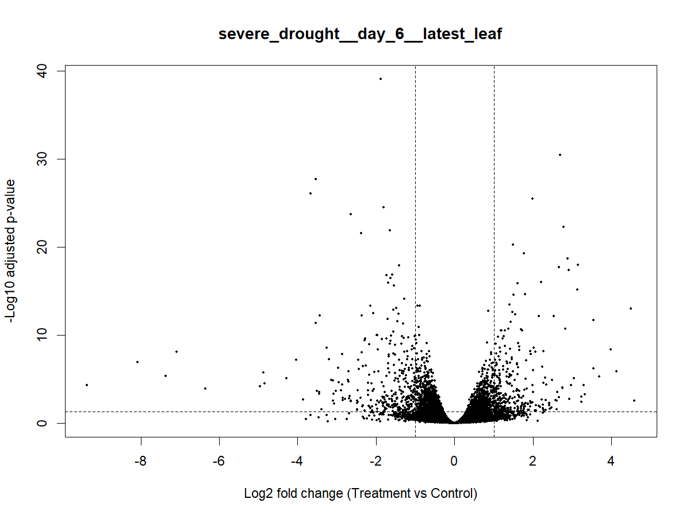
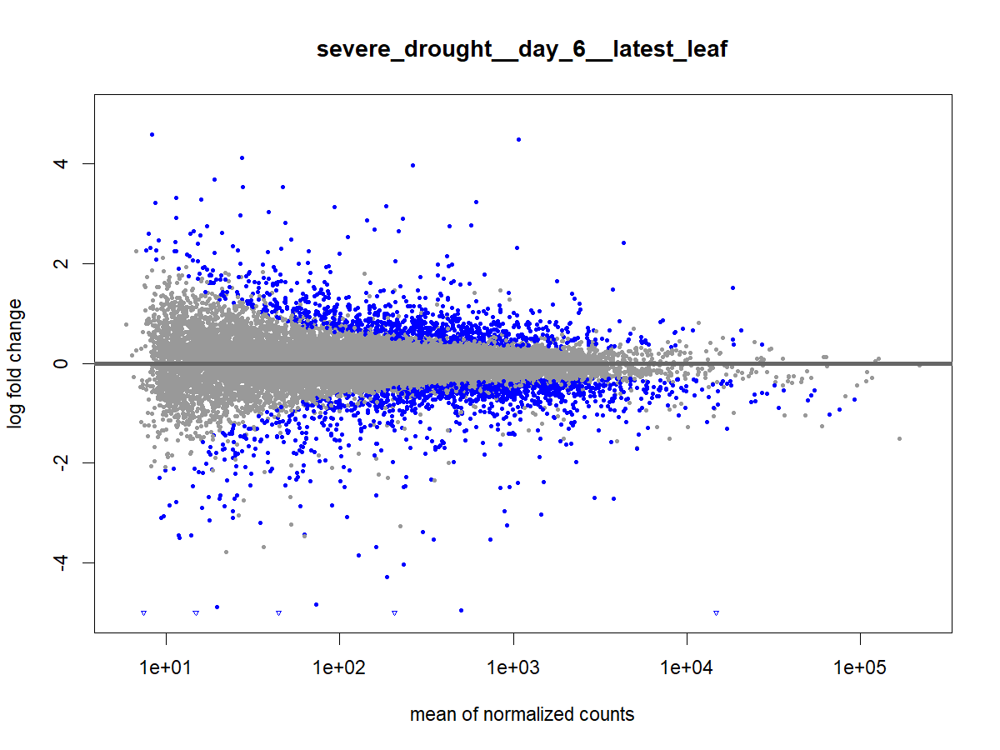
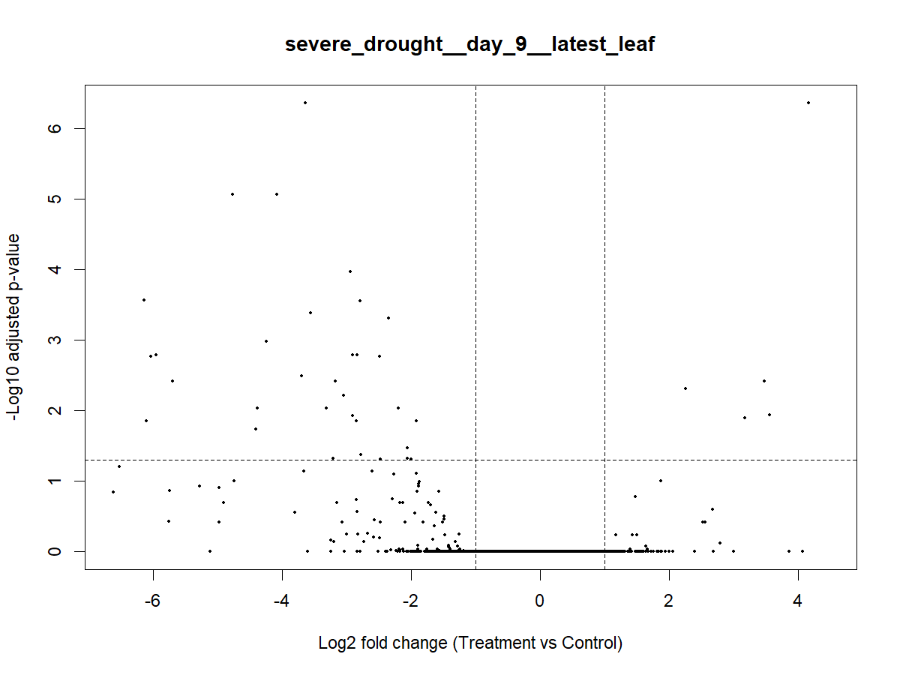
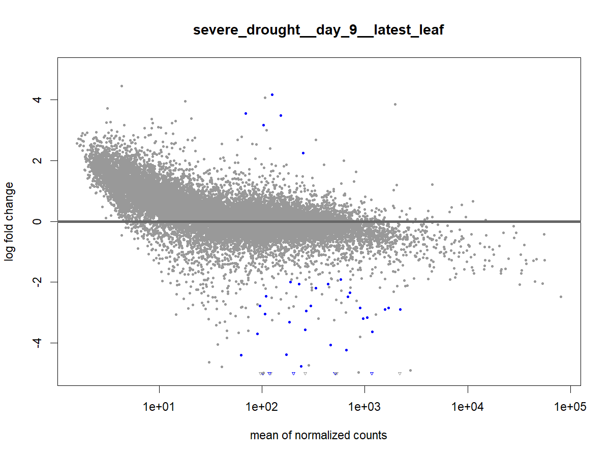

# CropStress Intelligence
### An RNA-seq Analysis of Rice Responses to Drought Stress and Rehydration

## 1. Abstract

CropStress Intelligence is a bioinformatics project investigating gene-expression patterns associated with drought stress and subsequent rehydration in rice (*Oryza sativa*). The project analyses publicly available RNA-sequencing data from the IR64 cultivar using R and established statistical methods. The workflow includes dataset acquisition, metadata integration, quality control, exploratory data analysis, expression filtering, gene-identifier investigation and differential expression analysis using DESeq2. The dataset contains 72 samples and 55,986 original expression records. Preliminary filtering retained 21,910 records. Eight differential expression comparisons were conducted across two leaf tissues and four experimental conditions. A low-count sample was also investigated through sensitivity analysis. Biological interpretation remains limited because the complete mapping between expression records and validated gene identifiers has not been established.

## 2. Introduction

Rice is an important food crop, and environmental stresses such as drought can affect its growth and productivity. Understanding how plants respond to drought and recover after water becomes available again is important for agricultural research.

RNA sequencing (RNA-seq) provides a way to investigate gene-expression patterns under different experimental conditions. By comparing expression counts between treatment and control samples, researchers can identify features showing statistically significant expression differences.

This project, CropStress Intelligence, uses publicly available rice RNA-seq data to investigate expression changes during severe drought and subsequent rehydration.

### 2.1 Aim

To analyse rice RNA-seq expression data and identify expression patterns associated with drought stress and rehydration using reproducible bioinformatics methods in R.

### 2.2 Objectives

1. Obtain and inspect a publicly available rice RNA-seq dataset.
2. Extract and integrate sample metadata with the expression matrix.
3. Perform sample-level quality control and expression-data validation.
4. Conduct exploratory data analysis and preliminary expression filtering.
5. Investigate gene identifiers and annotation compatibility.
6. Perform differential expression analysis using DESeq2.
7. Investigate the influence of an unusually low-count sample.
8. Document the workflow and results for reproducibility.

## 3. Dataset Description

The project uses dataset GSE288615 from the NCBI Gene Expression Omnibus (GEO).

| Attribute | Description |
|---|---|
| Dataset accession | GSE288615 |
| Organism | *Oryza sativa* |
| Cultivar | IR64 |
| Data type | RNA-seq raw expression counts |
| Number of samples | 72 |
| Original expression records | 55,986 |
| Reference genome reported | IRGSP-1.0 |
| Analysis environment | R 4.6.2 |

The dataset includes severe drought, control and rehydration conditions. Samples were collected at different time points and from two leaf positions:

- Latest leaf
- Second latest leaf

The integrated sample metadata contains GEO accession, library name, cultivar, tissue, treatment, day, replicate and title.

The expression matrix and sample metadata were checked to ensure that sample identifiers corresponded correctly.

## 4. Methodology

The project was implemented in R using a staged bioinformatics workflow.

### 4.1 Data Import and Metadata Integration

The original expression matrix was imported from the GEO dataset. GEO sample information was extracted and organised into a structured metadata table.

The count matrix contained 55,986 expression records across 72 samples. Metadata integration was validated by checking sample identifiers and their ordering.

### 4.2 Sample Quality Control

Sample-level quality control included:

- Total library-size calculation.
- Number of detected expression records.
- Count-distribution inspection.
- Biological replicate comparison.
- Identification of unusually low-count samples.

One sample, `IR9AD2L1`, was identified as an unusual observation.

Its library size was 1,755 compared with the dataset median of 13,707,163. It contained 1,046 detected records and approximately 98.13% zero counts.

The sample was flagged for investigation rather than automatically removed.

### 4.3 Exploratory Data Analysis

Exploratory analysis was performed to understand the dataset structure and expression-count distribution.

The workflow included:

- Experimental-group distribution.
- Sample library-size distribution.
- Detected-record comparison.
- Expression-count statistics.
- Biological replicate inspection.

### 4.4 Expression Filtering

A preliminary expression filter was applied to reduce the number of low-expression records.

The filtering rule retained records with a raw count of at least 10 in at least three samples.

| Metric | Result |
|---|---:|
| Original records | 55,986 |
| Retained records | 21,910 |
| Removed records | 34,076 |
| Retention percentage | 39.13% |

The resulting filtered matrix contained 21,910 records across 72 samples.

This was a preliminary filtering step before differential expression analysis.

### 4.5 Gene Identifier Investigation

The original count matrix did not contain an explicit biological gene-identifier column.

A separate annotation investigation examined the available MSU7 GFF3 annotation file. It contained 55,986 gene records and 55,986 unique identifiers.

However, the matching number of records does not establish that the annotation identifiers correspond row-by-row to the original count matrix.

The study metadata reports the use of the IRGSP-1.0 reference genome, while the investigated GFF3 annotation represents MSU7.

A supplementary spreadsheet containing 588 gene identifiers was also investigated. All 588 identifiers matched the examined GFF3 identifier set.

This supports compatibility for those supplementary identifiers but does not establish a complete mapping for all 55,986 original expression records.

Consequently, technical feature identifiers were used in the differential expression analysis. Biological gene identities were not assumed from row order.

### 4.6 Differential Expression Analysis

Differential expression analysis was performed using the DESeq2 package.

The analysis used:

- Design formula: `~ condition`
- Size-factor estimation: `poscounts`
- Statistical significance threshold: adjusted p-value (FDR) < 0.05
- Additional effect-size threshold: absolute log2 fold change >= 1

Eight separate comparisons were conducted across the two leaf tissues.

The comparisons were:

1. Severe drought Day 6
2. Severe drought Day 9
3. Rehydration Day 3
4. Rehydration Day 6

Each original comparison contained three control and three treatment samples.

The analyses were conducted separately rather than combining different experimental conditions.

## 5. Results

### 5.1 Differential Expression Results

The number of statistically significant expression features varied across experimental conditions and leaf tissues.

| Comparison | Tissue | Significant features (FDR < 0.05) | FDR < 0.05 and abs(log2FC) >= 1 |
|---|---|---:|---:|
| Severe drought Day 6 | Latest leaf | 2,183 | 609 |
| Severe drought Day 9 | Latest leaf | 37 | 37 |
| Rehydration Day 3 | Latest leaf | 1 | 1 |
| Rehydration Day 6 | Latest leaf | 60 | 39 |
| Severe drought Day 6 | Second latest leaf | 811 | 447 |
| Severe drought Day 9 | Second latest leaf | 1,099 | 568 |
| Rehydration Day 3 | Second latest leaf | 7 | 6 |
| Rehydration Day 6 | Second latest leaf | 821 | 299 |

These results demonstrate differences in the number of significant expression features across the comparisons.

They represent statistical findings at the expression-feature level, not confirmed biological gene-level discoveries.

### 5.2 Differential Expression Visualisations

MA plots and volcano plots were generated for the eight comparisons.

They provide visual summaries of expression changes and statistical significance.

Example figures:

**Severe drought — Day 6 — Latest leaf**





**Severe drought — Day 9 — Latest leaf**





All generated MA and volcano plots are available in `results/figures/differential_expression/`.

### 5.3 Missing Adjusted P-value Investigation

Some differential expression result files contained missing adjusted p-values.

A diagnostic investigation examined DESeq2 independent filtering and Cook's distance handling.

The investigation showed that independent filtering accounted for most missing adjusted p-values in the severe drought Day 9 latest-leaf and Day 6 second-latest-leaf comparisons.

The original DESeq2 settings were preserved. Alternative settings were used for diagnostic comparison only and did not replace the primary results.

### 5.4 Outlier Sensitivity Analysis

The unusually low-count sample `IR9AD2L1` was investigated further using the severe drought Day 9 latest-leaf comparison.

Two analyses were compared:

| Metric | Original analysis | Without outlier |
|---|---:|---:|
| Total samples | 6 | 5 |
| Control samples | 3 | 3 |
| Treatment samples | 3 | 2 |
| Features tested | 18,700 | 18,700 |
| Significant features | 37 | 1,014 |

The significant-feature overlap was:

| Result | Number |
|---|---:|
| Significant in original analysis | 37 |
| Significant without outlier | 1,014 |
| Significant in both analyses | 37 |
| Only significant in original analysis | 0 |
| Only significant without outlier | 977 |

All 37 features significant in the original analysis remained significant in the sensitivity analysis.

However, excluding the sample reduced the treatment group to two replicates. The additional findings are therefore exploratory and should not be considered independently confirmed discoveries.

The original analysis containing all six samples remains the primary analysis.

## 6. Discussion

The analysis demonstrates a complete progression from RNA-seq data preparation and quality assessment to preliminary filtering and statistical differential expression testing.

The number of significant features differed considerably between drought and rehydration comparisons and between leaf positions. This suggests that expression responses may vary across experimental conditions and sampled tissues.

The low-count sample investigation also demonstrates the importance of sample quality assessment before interpreting differential expression results. The sensitivity analysis showed that the Day 9 latest-leaf comparison was particularly affected by the inclusion of this sample.

However, the results must be interpreted cautiously. The complete biological gene-identifier mapping has not been validated. Therefore, the analysis cannot currently identify specific genes or assign biological functions to the significant expression features.

Further work should establish the correct reference annotation and row-level mapping before conducting gene-specific functional interpretation.

## 7. Limitations

The project has several limitations:

1. The complete mapping between the original expression records and biological gene identifiers has not been validated.
2. The investigated MSU7 annotation cannot be assumed to match the IRGSP-1.0 count-generation reference.
3. Differential expression results currently use technical feature identifiers.
4. The low-count sample affects the severe drought Day 9 latest-leaf comparison.
5. The sensitivity analysis contains only two treatment replicates after excluding the unusual sample.
6. Missing adjusted p-values occur in some comparisons because of DESeq2 filtering and outlier handling.
7. Gene-specific biological interpretation and functional enrichment analysis require validated gene identifiers.

## 8. Conclusion

CropStress Intelligence developed a reproducible R-based workflow for analysing rice RNA-seq data associated with drought stress and rehydration.

The project integrated 72 samples, validated the expression matrix, performed quality control, retained 21,910 records after preliminary filtering and conducted eight DESeq2 comparisons.

The analysis identified statistically significant expression features across several experimental conditions. It also demonstrated the importance of investigating unusual samples through sensitivity analysis rather than automatically removing them.

The most important remaining challenge is validating the complete biological gene-identifier mapping. Addressing this limitation would allow future work to investigate specific drought-responsive genes and their biological functions.

## 9. Reproducibility and Project Structure

The project was developed using R 4.6.2, RStudio, Git and GitHub.

Main project structure:

```text
CropStress_Intelligence/
│
├── code/
│   ├── 00_run_all.R
│   ├── 01_extract_metadata.R
│   ├── 02_import_counts.R
│   ├── 03_integrate_metadata.R
│   ├── 04_sample_quality_control.R
│   ├── 05_gene_identifier_inspection.R
│   └── ...
│
├── data/
│   ├── raw/
│   └── processed/
│
├── references/
│
├── reports/
│   ├── dataset_and_methodology.md
│   ├── exploratory_data_analysis.md
│   ├── gene_annotation_investigation.md
│   ├── quality_control_and_filtering.md
│   └── differential_expression_analysis.md
│
└── results/
    ├── figures/
    └── tables/
```

### Reproducing the Analysis

1. Clone or download the project repository.
2. Open the RStudio project from the project root directory.
3. Ensure the required raw dataset and reference files are available in their expected folders.
4. Install the required R packages, including DESeq2.
5. Execute the analysis scripts in their documented workflow order.
6. Inspect the generated tables, figures and reports.

The raw dataset is not necessarily distributed with the repository. Users should obtain it from the original GEO accession and place it in the expected project directory.

Generated statistical results, figures and documentation are organised under `results/` and `reports/`.

## 10. References

1. NCBI Gene Expression Omnibus. Dataset GSE288615. Rice (*Oryza sativa*) RNA-seq expression dataset.
2. Love, M. I., Huber, W., and Anders, S. (2014). Moderated estimation of fold change and dispersion for RNA-seq data with DESeq2. *Genome Biology*, 15, 550.
3. R Core Team. R: A Language and Environment for Statistical Computing.
4. Bioconductor. DESeq2 package documentation.
5. MSU Rice Genome Annotation Project. Rice genome annotation resources.